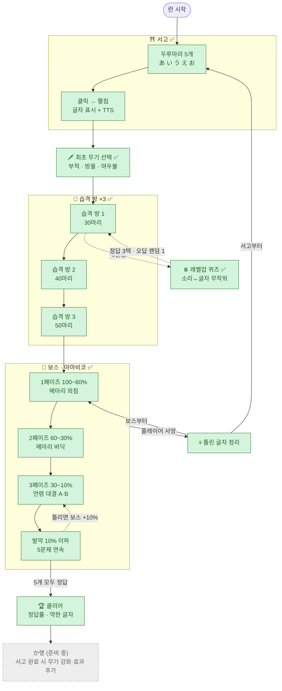

# 제작도 — 언령(言霊) 로그라이크

> 기획과 제작이 어디까지 왔는지 한눈에 보는 지도. 세부 내용은 [기획서.md](기획서.md) 참고.
>
> **범례** ✅ 설계 확정 · 🔍 검토 중 · ⬜ 미정 · ⏸️ 보류 · 🛠️ 제작 중 · 🎮 구현 완료

---

## 1. 한 판의 흐름 (챕터 1 · あ행)



---

## 2. 제작 트리

```
언령 로그라이크
│
├── 0. 기반 결정
│   ├── ✅ 언어: 일본어 / 타깃: 한국인 학습자 / 목표: 출시
│   ├── ✅ 플랫폼: 웹 먼저 → PC·모바일
│   ├── ✅ 세계관: 언령(言霊)·요괴, 거점 신사
│   ├── ✅ 아트: 간단한 도트 — 640×360, 16px, 언령 팔레트
│   ├── ✅ 학습 글자: 도트 + 고해상도 교과서체 혼합
│   ├── ✅ 에셋: 프로토는 코드 도트 → 무료 에셋은 그때그때 소개
│   ├── 🔍 엔진: Phaser + TypeScript (잠정)
│   ├── 🔍 학습 글자 폰트: Klee One (교과서체)
│   └── 🔍 UI 픽셀 폰트: Galmuri / DotGothic16 (확인 필요)
│
├── 1. 챕터 1 프로토타입 — あ행  ◀ 현재 작업
│   │
│   ├── ⛩️ 서고 ✅  ◀ 제작 시작
│   │   ├── ✅ 도트 예시: 플레이어 · 봉인/펼친 두루마리 · 서고 장면
│   │   ├── ✅ 봉인된 두루마리 5개 (あ い う え お)
│   │   ├── ✅ 클릭 → 펼침 연출 → 글자 표시 + TTS 낭독
│   │   ├── ✅ 서고에는 퀴즈 없음
│   │   └── ✅ 완료 보상: 최초 무기 선택
│   │
│   ├── 🗡️ 최초 무기 ✅
│   │   ├── ✅ 📜 부적 — 가장 가까운 적에게 투사체
│   │   ├── ✅ 🔔 방울 — 주변 원형 음파
│   │   └── ✅ 🦊 여우불 — 몸 주위 회전
│   │
│   ├── 👹 습격 방 ×3
│   │   ├── ✅ 이동만, 공격은 자동
│   │   ├── ✅ 처치 수로 클리어 (30 / 40 / 50)
│   │   ├── ✅ 요괴 처치 → 언령 구슬(경험치)
│   │   ├── ✅ 레벨업 퀴즈: 정지, 소리→글자 / 글자→소리 무작위
│   │   ├── ✅ 정답 → 업그레이드 3택 / 오답 → 정답 표시 + 랜덤 1개
│   │   ├── ⬜ 업그레이드 목록
│   │   ├── ⬜ 일반 요괴 종류 (2~3종)
│   │   └── ⬜ 플레이어 능력치 (체력·이동속도·피격)
│   │
│   ├── 👺 보스: 야마비코(山彦) ✅
│   │   ├── ✅ 피해: 자동 공격 + 퀴즈 정답(10%)
│   │   ├── ✅ 1페이즈 메아리 외침 — 소리 듣고 글자 클릭 (실패: 플레이어 피해)
│   │   ├── ✅ 2페이즈 메아리 바닥 — 글자 바닥으로 이동 (실패: 플레이어 피해)
│   │   ├── ✅ 3페이즈 언령 대결 — 실패 시 보스 +10%
│   │   │   ├── ✅ A: 글자 → 한글 발음 입력
│   │   │   └── ✅ B: 한글 발음 → 글자 클릭
│   │   └── ✅ 발악 (10% 이하) — 5문제 연속, 모두 맞혀야 처치
│   │
│   └── 🏁 결과 ✅
│       ├── ✅ 클리어: 정답률 · 약한 글자 → か행(준비 중)
│       └── ✅ 패배: 틀린 글자 정리 → 보스부터 / 서고부터 선택
│
├── 2. 공통 시스템
│   ├── ✅ 언령 집중: 정지형 + 슬로우·제한시간형 (프로토는 고정 제한시간)
│   ├── ✅ 한글 입력 판정: 한/영 상태 무관 (자판 위치)
│   ├── ✅ 음성: TTS → 이후 AI 보이스 녹음으로 교체
│   ├── ⬜ 간격 반복(SRS) · 숙련도별 제한시간
│   ├── ⬜ 원한 요괴 (자주 틀린 글자 → 엘리트 몬스터)
│   └── ⬜ 도감
│
├── 3. 프로토타입 이후 확장
│   ├── ✅ か행~: 서고 완료 시 무기 강화·효과 추가 (규칙만)
│   ├── ⬜ 결투 방 (로마자 타이핑) · 함정 방 · 어둠의 방 (듣기)
│   ├── ⬜ 신의 가호 빌드 (아마테라스 · 스사노오 · 츠쿠요미 · 이나리)
│   ├── ⬜ 신사 거점 · 영구 강화 · NPC 스토리
│   ├── ⬜ 한국인 특화: 한자음 브리지, 취약 유형 함정 방
│   ├── ⬜ 콘텐츠: 가나 전체 → N5 → N4
│   └── ⬜ 포팅·출시 (Electron/Tauri, Capacitor)
│
└── ⏸️ 보류 (추후 검토)
    ├── 서고: 발음 팁, 획순 애니메이션, 서고 퀴즈, 따라 쓰기, 연상 그림
    ├── 두 번째 런부터 서고 건너뛰기
    └── 무기: ⚔️ 신검
```

---

## 3. 진행 현황

| 구역 | 설계 | 제작 |
|---|---|---|
| ⛩️ 서고 | ✅ | 🛠️ 도트 예시 완료 |
| 🗡️ 최초 무기 | ✅ | ⬜ |
| 👹 습격 방 | 🔍 (업그레이드·요괴·능력치 남음) | ⬜ |
| 👺 보스 | ✅ | ⬜ |
| 🏁 결과 화면 | ✅ | ⬜ |

**다음 할 일**: 서고 제작 (프로젝트 세팅 → 서고 장면 → 두루마리 펼침 + TTS) → 업그레이드 목록 → 요괴 종류 → 플레이어 능력치
